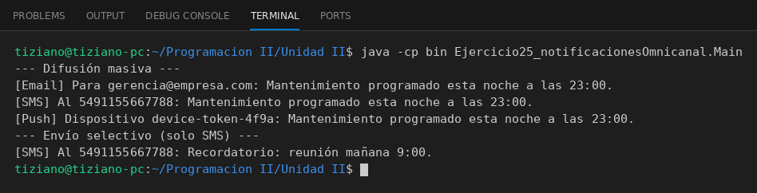

# CanalNotificacion

Programación II - Unidad 2 - Ejercicio 25

## Consigna
Un gestor de alertas difunde mensajes por múltiples canales usando una interfaz genérica de envío.

## Lógica
- Interfaz `CanalNotificacion` con `enviar(destinatario, mensaje)`.
- `NotificadorEmail` (valida `@`), `NotificadorSMS` (valida número y 160 caracteres) y `NotificadorPush` (valida token) tienen reglas propias.
- `GestorAlertas` guarda pares canal-destinatario; permite difusión masiva (`difundirATodos`) o selectiva (`enviarPorCanal`).
- `Main`: alerta masiva y luego un envío solo por SMS.

## Ejecución

